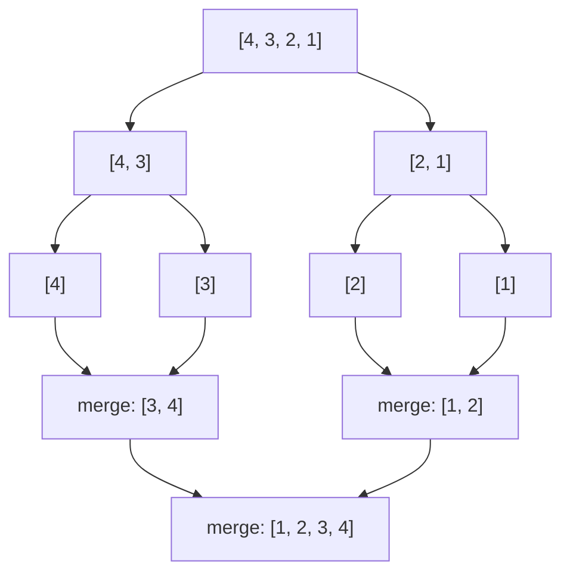

Merge sort is a **divide and conquer** algorithm. It never compares everything to everything. It keeps splitting the list until each piece has one item (which is trivially sorted), then merges pieces back together in order.

## The idea



## Merging two sorted lists

Merging is the only real work. Look at the first item of each list, take the smaller one, and repeat.

<Steps>
  <Step title="Start with two sorted lists">
    `left = [3, 4]` and `right = [1, 2]`
  </Step>
  <Step title="Compare the front items">
    `3` vs `1`: take `1`. Then `3` vs `2`: take `2`.
  </Step>
  <Step title="Append what's left">
    The right list is empty, so add the rest of the left list: `3, 4`.
  </Step>
</Steps>

## See it with the API

Ask `/sort/steps` to sort `[4, 3, 2, 1]` and it returns every merge:

<CodeGroup>
  ```bash Request
  curl -X POST http://localhost:8000/sort/steps \
    -H "Content-Type: application/json" \
    -d '{"numbers": [4, 3, 2, 1]}'
  ```

  ```json Response
  {
    "result": [1, 2, 3, 4],
    "count": 4,
    "order": "asc",
    "steps": [
      { "step": 1, "left": [4], "right": [3], "merged": [3, 4] },
      { "step": 2, "left": [2], "right": [1], "merged": [1, 2] },
      { "step": 3, "left": [3, 4], "right": [1, 2], "merged": [1, 2, 3, 4] }
    ]
  }
  ```
</CodeGroup>

<Info>
  The sort is **stable**: equal numbers keep their original order. It runs in O(n log n) time.
</Info>

<Expandable title="Read the code">
  The whole algorithm is about 25 lines in `main.py`: a `merge()` function that combines two sorted lists, and a recursive `merge_sort()` that splits the list and calls `merge()`.
</Expandable>

Ready to try it? Head to the [quickstart](/merge-sort-api/quickstart).
